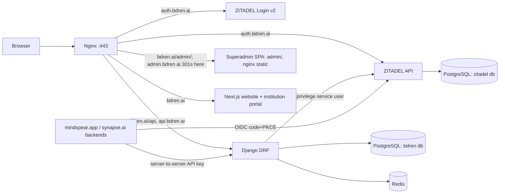

# BDREN Identity & Entitlement Platform — Architecture (Phase 0)

## Repository audit
`/home/bdren/projects/sso` was empty except `IMPLEMENTATION_PLAN.md`; greenfield. Sibling projects
(`MindSpear`, `bdrenai`, `QuestizSurvey`) are separate repos and are untouched; they are future OIDC clients.

Toolchain on host: Python 3.12, Node 18.19 (Next.js ≤15 OK; Next 16 needs Node 20 — build in Docker with Node 22), Docker 29, Compose v5.

## Separation of concerns
| Concern | Owner |
|---|---|
| Who is the user (passwords, MFA, passkeys, sessions, federation) | ZITADEL v4.20.3 (pinned) |
| What can they access / how much (products, packages, subscriptions, quotas) | Django |

Django identifies users only by `(issuer, subject)` (unique). No email-based auto-linking.

## Topology (Docker Compose, single host)

Routing note: plan asks for `bdren.ai/admin` and `bdren.ai/api` *and* lists `admin.`/`api.` hosts. Decision: **canonical** URLs
are `bdren.ai/admin` and `bdren.ai/api`; `admin.bdren.ai` / `api.bdren.ai` are 301/alias vhosts. `auth.bdren.ai` stays separate.
The superadmin SPA (`admin/`, Vite build with `base: '/admin/'`) is its own container; nginx sends `bdren.ai/admin/` to it
and `admin.bdren.ai/<path>` 301s to `bdren.ai/admin/<path>`, so it shares the `bdren_session` cookie with Django.

## ZITADEL v4 facts verified
- v4 splits the hosted Login UI into a separate image `ghcr.io/zitadel/zitadel-login` (Login v2) served at `/ui/v2/login`; needs an `IAM_LOGIN_CLIENT` service-user PAT, bootstrapped via shared volume.
- Official compose uses Traefik; we replace it with Nginx (plan requirement). gRPC is routed via `grpc_pass`.
- Redis is optional for ZITADEL caching; disabled initially.

## Risks / items to verify in later phases
1. **eduGAIN**: generic SAML IdP support ≠ eduGAIN. Needs federation metadata aggregate + trust config; verify ZITADEL SAML SP metadata/entity-category support in Phase 3 and document limitations.
2. **Org-scoped login policies / IdP restrictions** — confirm availability in OSS edition (Phase 3).
3. **WebAuthn requires HTTPS + stable RP ID** — passkeys can't be fully tested over plain-HTTP dev (`*.localhost` is a secure context, which helps).
4. **Admin MFA enforcement**: ZITADEL login policy `forceMfa` (+ Django-side check of `amr`/`acr` claim for admin routes).
5. **Domain cookies**: Django API and apps use own cookies; no cross-domain cookie sharing.
6. TLS: Let's Encrypt via certbot, or provided certs, in Phase 7 (prod overlay).

## Phases
See `IMPLEMENTATION_PLAN.md` §18; status in `DEVELOPMENT_PROGRESS.md`.
