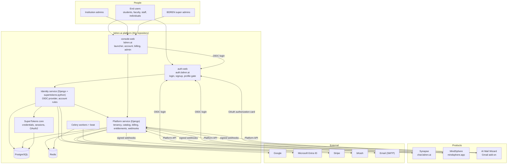
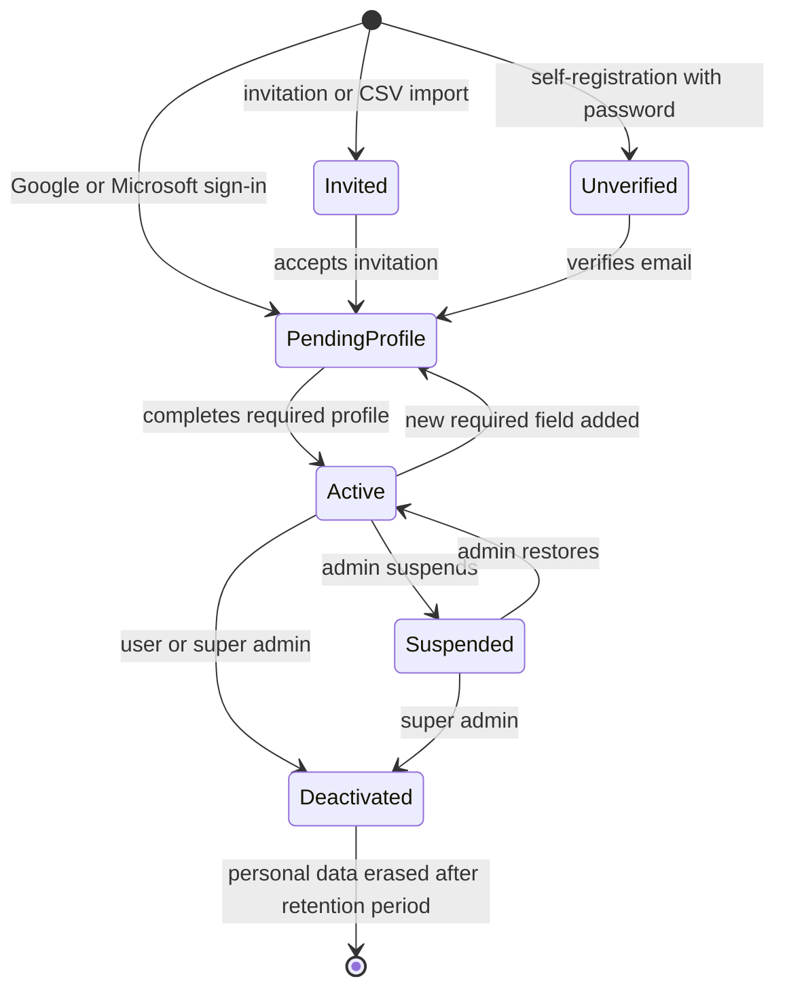
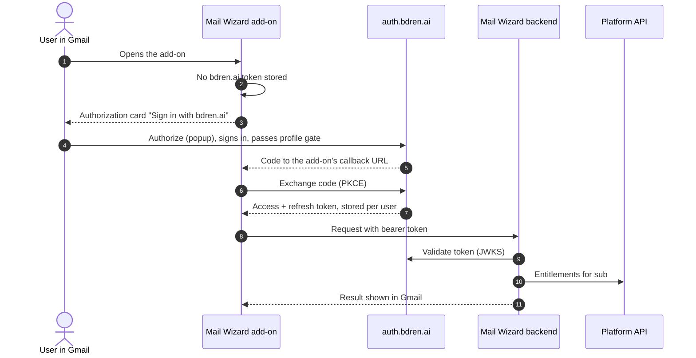
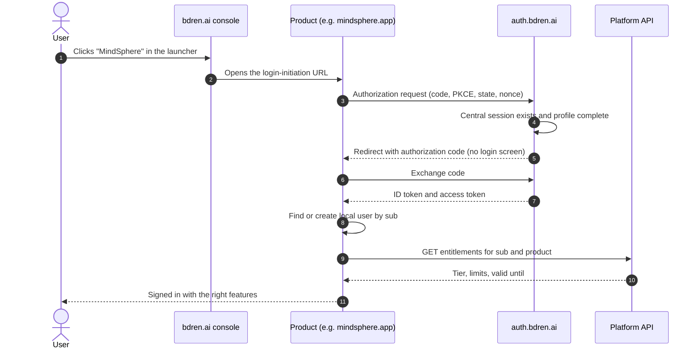
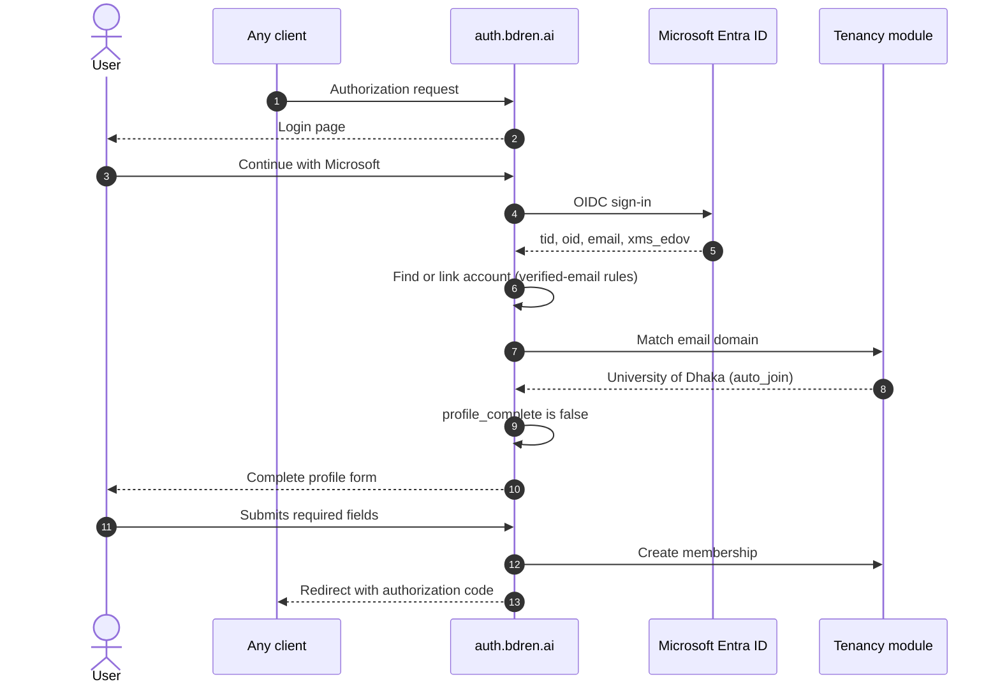
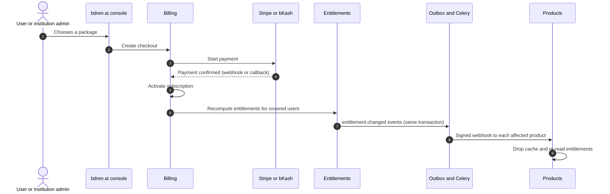
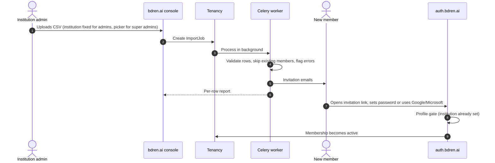

# bdren.ai — North Star Architecture

| | |
|---|---|
| **Status** | Draft v0.1, for team review |
| **Date** | 2026-11-10 |
| **Scope** | The bdren.ai platform (accounts, institutions, packages, payments, single sign-on) and the contract between it and every BDREN product |
| **Decisions so far** | No Keycloak. SuperTokens is the identity engine, hosted inside this Django codebase, with the paid Unified Login (OIDC provider) and Multi-tenancy add-ons available. |

---

## 0. How to use this document

This is the **target state**: what bdren.ai should look like when it's done. It is not a sprint plan. Phase, milestone and task plans come later and should:

- refer to section numbers here (for example "implements §8.4"), so every piece of work traces back to the North Star;
- change this document only through a decision record (§16). If a phase plan needs to break a rule here, write the decision first and then update this file.

Words like **must**, **should** and **may** are used deliberately. "Must" means a design that breaks it is wrong. "Should" means the default unless there's a written reason. "May" means optional.

---

## 1. Vision

**bdren.ai is the single front door to every AI product BDREN offers.** It plays the role openai.com plays for ChatGPT and the OpenAI platform: one account, one place to buy, one place to manage access.

- A person signs up **once** and uses MindSphere, Synapse, AI Mail Wizard and every future product with the same account.
- A university is onboarded **once**. Its admins manage their own people, and BDREN manages the institutions.
- A package is bought **once** and unlocks the right features in every product it covers, wherever that product is hosted.

```
                          ┌──────────────────────────────┐
                          │        auth.bdren.ai          │
                          │   one account, one sign-in    │
                          └──────────────┬───────────────┘
            ┌─────────────────┬──────────┴─────────┬──────────────────────┐
            ▼                 ▼                    ▼                      ▼
     bdren.ai console    chat.bdren.ai       mindsphere.app       AI Mail Wizard
  (accounts, institutions, (Synapse)          (MindSphere)        (Gmail add-on)
   packages, payments,
   app launcher)
```

---

## 2. Goals, non-goals and success measures

### 2.1 Goals

| # | Goal |
|---|---|
| G1 | One identity across all BDREN products, regardless of domain. |
| G2 | Institution-based user management: BDREN creates institutions; institution admins fully manage their members. |
| G3 | Open self-registration, with every user attached to an institution (or a pending "Other" request). |
| G4 | Google and Microsoft sign-in with institutional email, plus email/password. |
| G5 | A mandatory profile-completion gate that no product can bypass. |
| G6 | Packages that cover one product or many, bought by individuals or institutions, paid through Stripe or bKash. |
| G7 | Entitlement changes reach every product within a minute. |
| G8 | Adding a new product is a configuration and integration task, not a platform rewrite. |

### 2.2 Non-goals (for now)

- bdren.ai does not host product features. MindSphere's surveys, Synapse's chats and so on stay in their products.
- bdren.ai does not replace each product's own database. Products keep their data and link it to the bdren.ai user ID.
- A public developer platform with API keys and usage billing (like platform.openai.com) is a later horizon (§15), not part of the first build.

### 2.3 Success measures

| Measure | Target |
|---|---|
| Products using bdren.ai sign-in | 100% of BDREN products; no product-local passwords after migration |
| Time from purchase to features unlocked in a product | Under 60 seconds |
| Time to onboard a new institution (create, admin invited, domain set) | Under 15 minutes of super-admin work |
| Users with a complete profile | 100% of active users (enforced, not hoped for) |
| auth.bdren.ai availability | 99.9% monthly |

---

## 3. Guiding principles

These hold for every design decision. When a phase plan is unclear, these break the tie.

1. **One identity, many products.** Every person has exactly one bdren.ai account, identified by one stable ID (`sub`). Products never create their own accounts for users.
2. **Standards at the boundaries.** Products talk to bdren.ai only through OpenID Connect / OAuth 2.0, a documented REST API, and signed webhooks. **Products must never import SuperTokens SDKs or read bdren.ai's database.** That keeps the identity engine replaceable without touching any product.
3. **The console is just another client.** bdren.ai's own console signs in through auth.bdren.ai exactly like MindSphere does. No back doors, so the SSO path is always tested.
4. **Gate at the door.** Rules that apply to everyone, such as email verification and profile completion, are enforced at auth.bdren.ai before any product receives a login. Products never have to re-check them.
5. **One writer per piece of data.** Each kind of data has exactly one owner that may change it (§10.2). Everyone else reads it or receives events.
6. **Entitlements are pulled; changes are pushed.** Products ask the Platform API what a user can do, and bdren.ai pushes a signed webhook whenever that changes. Tokens carry identity, not billing state.
7. **Institution-first, individual-friendly.** The data model is built around institutions, but an individual can still sign up, pay and use products without an institution sponsoring them.
8. **Secure by default.** PKCE on every client, MFA for every admin, short-lived tokens, audit logs on every admin action.
9. **Extend the boilerplate; don't rewrite it.** The existing billing, admin, branding and frontend code is the starting point (§14).

---

## 4. Product landscape

| Product | Domain / channel | Type | Integration style |
|---|---|---|---|
| **bdren.ai console** | `bdren.ai` | This repository | First OIDC client; owns accounts, institutions, packages, payments, launcher |
| **auth.bdren.ai** | `auth.bdren.ai` | This repository | The sign-in server (OIDC provider) |
| **Synapse** | `chat.bdren.ai` | Web app | OIDC client (confidential, server-side) |
| **MindSphere** | `mindsphere.app` | Web app on a separate domain | OIDC client (confidential, server-side) |
| **AI Mail Wizard** | Google Workspace Marketplace (Gmail add-on) | Add-on | OAuth authorization card in the add-on (§9.4) |
| Future products | Any domain | Any | Same contract (§9) |

Because MindSphere lives on a different registrable domain, cookies cannot be shared between it and bdren.ai. **Single sign-on must therefore be redirect-based (OIDC), not cookie-based.** This is the main reason auth.bdren.ai exists as a separate sign-in server.

---

## 5. Target architecture

### 5.1 System context



### 5.2 Components and responsibilities

| Component | Hostname | Owns | Must not |
|---|---|---|---|
| **auth-web** (Next.js) | `auth.bdren.ai` | Login, registration, social sign-in buttons, email verification, password reset, profile completion, MFA screens, consent | Show billing or admin features |
| **Identity service** (Django role + supertokens-python) | `auth.bdren.ai/api/...` | SuperTokens recipes and overrides, account-linking rules, signup protection, adding bdren.ai claims to tokens, enforcing the profile gate | Decide entitlements |
| **SuperTokens core** | Internal only | Credentials, login methods, sessions, OAuth2 clients and tokens, tenants | Be reachable from the internet |
| **console-web** (Next.js) | `bdren.ai` | Marketing pages, pricing, app launcher, account pages, institution admin, super admin | Handle passwords or social sign-in directly |
| **Platform service** (Django role) | `bdren.ai/api/...` (console) and `api.bdren.ai/v1` (products) | Institutions, memberships, invitations, imports, product catalog, packages, subscriptions, payments, entitlements, usage, webhooks, audit | Store credentials |
| **Celery workers + beat** | Internal | Email sending, CSV imports, webhook delivery, subscription expiry, payment reconciliation | |
| **PostgreSQL** | Internal | All persistent data (Django schema and SuperTokens schema kept separate) | |
| **Redis** | Internal | Cache, rate limits, Celery broker | Hold anything that can't be rebuilt |

### 5.3 Deployment topology

- **One Django codebase, two runtime roles.** The same project is deployed twice: `ROLE=identity` serves auth.bdren.ai's API, and `ROLE=platform` serves the console API and the Platform API. Each role loads only its own URLs and middleware. This keeps the sign-in server small and isolated without maintaining two codebases.
- **Separate cookies per host.** auth.bdren.ai session cookies are host-only, so bdren.ai (and everything else) can never read them.
- **SuperTokens core** runs as its own container (it is a Java service) on the private network, with its own database schema. Whether it is self-hosted or SuperTokens' managed service depends on the Phase 0 check in §6.2.
- **Two Next.js apps** (auth-web, console-web) share one UI package so branding and components stay consistent. Early on they may run as one Next.js deployment with host-based routing, but the code must stay separated so they can split without rework.
- **Environments:** local, staging (`*.staging.bdren.ai`), production. Every product has a staging OIDC client pointing at staging auth.

### 5.4 Codebase layout (target)

```
bdrenai/
├── backend/                     Django project (modular monolith)
│   ├── bdrenai/                 settings, per-role URLconfs, middleware
│   ├── identity/                SuperTokens init + overrides, account linking, signup protection,
│   │                            profile gate, token claims  (grows out of accounts/)
│   ├── tenancy/                 institutions, domains, memberships, invitations, imports, "Other" requests
│   ├── catalog/                 products, product tiers, OIDC client registry, webhook endpoints
│   ├── billing/                 packages, subscriptions, seats, Stripe, bKash  (grows out of subscriptions/)
│   ├── entitlements/            entitlement resolver, Platform API, usage records
│   ├── events/                  outbox, webhook signing and delivery
│   └── audit/                   audit log (grows out of bdrenai/audit.py)
├── frontend/
│   ├── apps/auth-web/           auth.bdren.ai
│   ├── apps/console-web/        bdren.ai
│   └── packages/ui/             shared components, branding, theme
├── sdk/                         small helper libraries for products (Python, Node, Apps Script snippet)
└── docs/                        this file, decision records, integration guide
```

**Module rule:** modules talk to each other through service functions, never by writing each other's tables. This is what lets a module become its own service later if needed.

---

## 6. Identity and single sign-on (auth.bdren.ai)

### 6.1 Engine: SuperTokens inside Django (ADR-001)

auth.bdren.ai runs **SuperTokens core** for credentials, sessions and OAuth2, driven by **supertokens-python** inside the Django identity role. Django overrides add everything specific to BDREN (institutions, profile gate, claims).

| Need | SuperTokens recipe | Paid? |
|---|---|---|
| Email/password sign-up, sign-in, password reset | EmailPassword | No |
| Google, Microsoft, LinkedIn sign-in | ThirdParty (built-in providers) | No |
| Email verification | EmailVerification | No |
| Sessions on auth.bdren.ai | Session | No |
| Being the OIDC provider for other domains | OAuth2Provider ("Unified Login") | **Yes** |
| One account across Google + Microsoft + password with the same email | AccountLinking | **Yes** |
| TOTP for admins | MultiFactorAuth + TOTP | **Yes** |
| Institution-specific login providers (campus SSO, SAML) | Multitenancy | **Yes** |
| Keeping the existing Django user UUIDs as the public user ID | User ID mapping | No |

**What SuperTokens owns vs what Django owns:**

| SuperTokens (identity engine) | Django (bdren.ai) |
|---|---|
| Passwords and password hashes | User profile (name, phone, designation, avatar, user type) |
| Login methods and linked Google/Microsoft accounts | Profile-completion state and required-field rules |
| Email verification status | Institutions, memberships, roles |
| Sessions on auth.bdren.ai | Products, packages, subscriptions, entitlements |
| OAuth2 clients, codes, access/refresh tokens, signing keys | Invitations, imports, "Other" requests |
| Tenants and their login-method settings | Audit log, webhooks |

Django keeps a `User` row for every SuperTokens user. Through **user ID mapping**, the Django UUID is the public user ID, so `sub` in every token equals `User.id` in Django. Existing boilerplate user IDs survive unchanged.

### 6.2 Phase 0 verification gate

SuperTokens' own documentation is inconsistent on a few points that the whole design depends on. **These must be confirmed in writing with SuperTokens, and proven in a spike, before Phase 1 starts:**

| # | Question | Why it matters | If the answer is "no" |
|---|---|---|---|
| V1 | Is Unified Login (OAuth2Provider) available on **self-hosted** core with a license key, or only on the managed service? Current docs say managed service only. | Decides where user credentials are stored. | Accept managed hosting (check V2), or fall back (below). |
| V2 | If managed: which region hosts the data, and is that acceptable for BDREN and its institutions? | Data residency and institutional trust. | Fall back. |
| V3 | Does the Python SDK support OAuth2Provider fully, at parity with Node.js? Some doc pages still say Node.js only. | The identity role is Django. | Run a small Node.js auth service for the OAuth2 endpoints only, or fall back. |
| V4 | Can a custom login UI (not the prebuilt React UI) drive the OAuth2 login flow (`loginChallenge`)? | auth-web reuses the boilerplate's own pages. | Use and theme the prebuilt UI. |
| V5 | Can the backend refuse to continue an OAuth2 login until a session claim (`profile_complete`) is true? | Principle 4 (gate at the door). | Enforce in our own API override before the redirect; verify it can't be skipped. |
| V6 | Does OAuth2Provider support OIDC back-channel logout? | Logging out everywhere. | Send our own `user.sessions_revoked` webhook (§9.3). |
| V7 | Is the `client_credentials` grant available for machine-to-machine tokens? | Platform API authentication. | Per-product API keys signed with HMAC. |
| V8 | Price at our expected scale (user count and tenant count) for Unified Login, Account Linking, MFA and Multitenancy. | Budget. | Revisit the fallback. |
| V9 | With user ID mapping in place, do OAuth2 tokens carry the mapped (Django) user ID as `sub`, including after account linking? | ADR-012: one stable `sub` everywhere. | Use SuperTokens' own user ID as `sub` and store it on the Django `User`. |

**Fallback engine:** a Django-native OIDC provider (django-allauth's `allauth.idp.oidc` or django-oauth-toolkit). Because products only speak standard OIDC (principle 2), switching engines would change auth.bdren.ai's internals but **not a single product**.

### 6.3 The OIDC contract

This contract is what products depend on. It must not change without a decision record.

**Discovery.** Products configure only the issuer `https://auth.bdren.ai` and read every endpoint from its OpenID discovery document. Endpoint paths are never hard-coded.

**Client types:**

| Client | Type | Grant | Notes |
|---|---|---|---|
| bdren.ai console | Confidential (server-side) | Authorization code + PKCE | Platform role exchanges the code and issues its own console session cookie |
| Synapse, MindSphere | Confidential (server-side) | Authorization code + PKCE | Tokens stay on the product's server, never in browser storage |
| AI Mail Wizard | Confidential (Apps Script / add-on backend) | Authorization code + PKCE, refresh tokens | §9.4 |
| Product backends calling the Platform API | Confidential | Client credentials | Scoped per product |

**Rules for every client:** exact redirect-URI matching; PKCE required; no implicit or password grants; `state` and `nonce` always checked.

**Scopes:**

| Scope | Grants |
|---|---|
| `openid` | `sub` |
| `profile` | Name, picture, designation, user type |
| `email` | `email`, `email_verified` |
| `institution` | The `institution` claim |
| `offline_access` | Refresh token (only for clients that need it, such as the add-on) |

**bdren.ai claims** (added by Django overrides; present in the ID token and access token when the scope allows):

| Claim | Example | Meaning |
|---|---|---|
| `sub` | `"3f1c…"` | Stable bdren.ai user ID (Django `User.id`) |
| `institution` | `{"id": "…", "name": "University of Dhaka", "role": "member", "status": "active"}` | Primary institution, or `null` |
| `user_type` | `"faculty"` | Student, faculty, staff, researcher, other |
| `platform_role` | `"super_admin"` | Only present for BDREN staff roles |
| `profile_complete` | `true` | Always true in tokens issued to clients (the gate guarantees it) |

**Not in tokens:** packages, subscriptions, limits. Those come from the Platform API (principle 6), because tokens can't be updated after they are issued.

**Token lifetimes (initial targets, tune after launch):**

| Token / session | Lifetime |
|---|---|
| Access token | 10 minutes |
| ID token | 10 minutes (used once at login) |
| Refresh token | Rotating; 30 days, revoked on reuse |
| auth.bdren.ai session | 12 hours idle, 30 days absolute with "remember me" |
| Product sessions | Product's choice, but must end on logout events (§6.7) |

### 6.4 Login methods and account linking

| Method | Notes |
|---|---|
| Email + password | Email verification is required before the profile gate. |
| Google | Workspace accounts carry an `hd` (hosted domain) claim, used for institution matching. |
| Microsoft (Entra ID, multi-tenant) | Identify users by `tid` + `oid`, not by email. Treat the email as verified only when Microsoft sends `xms_edov=true`; otherwise send our own verification email. |
| LinkedIn | Optional, off by default (open question Q5). |
| Institution's own IdP (SAML or OIDC) | Later horizon, through a dedicated SuperTokens tenant (§6.5). |

**Account linking rules** (configured through SuperTokens AccountLinking, carried over from the boilerplate's `resolve_social_login` logic):

1. A new sign-in method links automatically to an existing account **only** if both sides have a verified email that matches.
2. If either email is unverified, the user must prove ownership (verify the email, or sign in with the existing method first) before linking.
3. Linking never merges two accounts that both already hold subscriptions or memberships; that needs a super-admin merge tool.

### 6.5 How SuperTokens multi-tenancy is used

In SuperTokens, each tenant normally has **its own user pool and its own login methods**. That's useful for login configuration, but it's the wrong tool for modelling institution membership: it would split users into separate pools and doesn't model admins, invitations or seats.

So:

- **All users live in one tenant (`public`) by default.** Institution membership and roles live in Django (§7).
- **An institution gets its own SuperTokens tenant only when it needs its own login configuration**, for example:
  - signing in through the university's own Microsoft tenant or SAML IdP (campus SSO);
  - forcing a specific login method for that institution's members;
  - an institution-branded login page.
- `Institution.auth_tenant_id` links the two. auth-web asks for the email first, maps the domain to an institution, and if that institution has its own tenant, shows that tenant's login options.
- Users signing in through an institution tenant are associated with that tenant **and** keep the same bdren.ai account (same `sub`) everywhere.

This keeps the paid Multitenancy add-on for the job it does well (per-institution login) and keeps business tenancy in one place (Django).

### 6.6 Profile-completion gate

**Rule:** no client, including the console, receives an authorization code for a user whose profile is incomplete.

- The identity service keeps a `profile_complete` session claim, computed from Django's required-field rules.
- The OAuth2 login flow must not continue while the claim is false (V5). auth-web sends the user to `/complete-profile` and then resumes the original login request.
- The required fields are configured by super admins. Initial set:
  - first name, last name
  - institution (from the dropdown) **or** "Other" plus a free-text name
  - user type (student, faculty, staff, researcher, other)
  - designation
  - phone (required or optional, configurable)
  - acceptance of the terms and privacy policy
- **Profile schema versions:** if a super admin adds a new required field, the version goes up and every user is sent through the gate again at their next login.
- **Console guard as a second layer:** the console API also refuses everything except `/me/profile` endpoints for incomplete profiles, in case a session predates a schema change.

### 6.7 Sessions, logout and MFA

- **Single logout:** a user who logs out of any product is sent to auth.bdren.ai's end-session endpoint, which ends the central session and notifies every other product (back-channel logout if available, otherwise the `user.sessions_revoked` webhook).
- **Admin actions:** "sign out everywhere", suspension and deactivation revoke all refresh tokens and notify all products.
- **MFA:** required for super admins and institution admins (TOTP to start, passkeys later). Members may turn it on.
- **Step-up:** sensitive console actions (changing prices, appointing admins, bulk deletes) require a recent MFA check.

---

## 7. Tenancy and user management

### 7.1 Hierarchy

```
BDREN (platform owner, super admins)
 ├── University of Dhaka            ← institution
 │    ├── Institution admins        ← e.g. ICT director
 │    └── Members                   ← students, faculty, staff
 ├── University of Rajshahi
 │    └── …
 └── Individuals with no sponsoring institution (or a pending "Other" request)
```

- **Super admin** is a *platform role*, not an institution role. BDREN staff may also be members of a "BDREN" institution like anyone else.
- **One primary institution per user** to start (ADR-007). The schema allows several memberships so this can be relaxed later without a migration.

### 7.2 Roles and permissions

| Capability | Super admin | Institution admin | Member |
|---|---|---|---|
| Create, edit, suspend institutions | Yes | Edit own profile only | — |
| Add or verify institution email domains | Yes | Request only | — |
| Invite, create or CSV-import members | Any institution (institution picker) | Own institution | — |
| Appoint or remove institution admins | Yes | Own institution (configurable) | — |
| Suspend or remove members | Yes | Own institution | — |
| View members and usage | All | Own institution | Own |
| Review "Other" institution requests | Yes | — | — |
| Manage products, packages, prices | Yes | — | — |
| Buy packages | Yes | For own institution | For self |
| Assign institution seats | Yes | Own institution | — |
| Manual entitlement grants (trials, complimentary access) | Yes | — | — |
| Platform settings (signup policy, providers, required fields, branding) | Yes | — | — |
| Audit log | All | Own institution | Own activity |

**Implementation rule:** one permission check, `can(actor, action, institution)`, used by every console endpoint. Super admins pass for any institution; institution admins only for their own. The same screens serve both, with the institution picker shown only to super admins.

### 7.3 Ways a user gets in

| Path | Steps | Institution |
|---|---|---|
| **Invitation** | Admin invites by email → user opens link → sets a password or uses Google/Microsoft → profile gate | Set by the invitation |
| **CSV import** | Admin uploads CSV (email, names, user type, role) → background job validates → creates pending accounts and sends invitations → admin gets a per-row report | Chosen at upload (super admins pick it) |
| **Admin creates directly** | Same as invitation, but the admin fills in the profile; the user still sets their own password | Chosen by the admin |
| **Self-registration** | auth.bdren.ai sign-up → email verification → profile gate with institution dropdown or "Other" | Selected, or pending "Other" request |
| **Google / Microsoft** | Sign in → email domain matched to an institution → profile gate | Matched by domain, or selected |

**Email-domain policy** (per institution domain, set by super admins after verifying the domain):

| Policy | Effect |
|---|---|
| `auto_join` | A verified email at this domain becomes a member automatically. |
| `approval` | The user is suggested this institution; an institution admin approves. |
| `off` | Domain is recorded but not used for matching. |

### 7.4 "Other" institution requests

1. The user picks "Other" and types a name. Their account becomes active as an **individual** with a pending request.
2. Super admins see a review queue, with similar existing institutions suggested by name and email domain.
3. A super admin either **approves** (creates the institution; the user joins it), **merges** (attaches the user to an existing institution), or **rejects**.
4. Until the request is resolved, the user can use free tiers and anything they buy for themselves, but nothing an institution sponsors.

### 7.5 User lifecycle



Every transition writes an audit entry and, where products care (suspension, deactivation, profile changes), emits a webhook.

---

## 8. Packages, billing and entitlements

### 8.1 Concepts

| Concept | Meaning | Example |
|---|---|---|
| **Product** | Something BDREN offers, with its own domain and OIDC client | MindSphere |
| **Product tier** | A level of access the product itself understands, with default limits | `mindsphere:pro` with `{"surveys": 25, "responses_per_month": 10000}` |
| **Package** | What is sold. Contains one or more product tiers, optionally with overridden limits | "MindSphere Pro" (one product) or "All-Access Pro" (MindSphere Pro + Synapse Pro + Mail Wizard Pro) |
| **Subscription** | A package held by a **user** or an **institution**, for a billing period | University of Dhaka holds "All-Access Pro" for 500 seats |
| **Seat** | One user covered by an institution's subscription | Dr. X uses one of Dhaka's 500 seats |
| **Entitlement** | The effective result for one user and one product | User X → MindSphere `pro`, limits {…}, valid until 2027-06-30, source: institution |

Each product registers its tier vocabulary in the catalog. bdren.ai never needs to understand what a "survey" is; it just passes the limits through.

### 8.2 Entitlement resolution

For user **U** and product **P**, collect every source:

1. U's own active subscriptions that include P;
2. institution subscriptions that cover U (all members, or an assigned seat);
3. manual grants by super admins (with expiry);
4. P's free tier, if the product has one.

**The highest-ranked tier wins**, and its limits apply as a whole (limits are not mixed across sources). The result records which source granted it, so support can answer "why does this user have Pro?".

Subscription states that still grant access: `active`, `trialing`, `past_due` within the grace period, and `canceled` until the period ends. `expired` and `suspended` do not.

### 8.3 Payments

| Method | Use | Status in boilerplate |
|---|---|---|
| Stripe | International cards, USD, recurring | Exists (checkout, webhooks, portal) |
| bKash | Local payments, BDT | Exists (tokenized checkout, callbacks, refunds, SNS) |
| Manual invoice | Institutions paying by purchase order or bank transfer | New: super admin records payment, subscription activates |

Prices are stored per package per currency and billing cycle. The payment provider only confirms payment; **bdren.ai's subscription record is the source of truth** for access.

### 8.4 Propagation to products

```
change happens ──► entitlements recomputed ──► outbox event (same DB transaction)
                                                    │
                                                    ▼
                                       Celery delivers signed webhook
                                                    │
                                                    ▼
                         product drops its cache and re-reads the Platform API
```

- **Pull:** products call `GET /v1/entitlements/{sub}?product={slug}` and may cache the answer for up to 5 minutes.
- **Push:** every change emits `entitlement.changed` to each affected product.
- **Safety net:** if a webhook is missed, the 5-minute cache limit bounds how stale a product can be. Products may also call a bulk "changed since" endpoint to reconcile.
- **Target:** under 60 seconds from payment confirmation to features unlocked (success measure §2.3).

### 8.5 Usage and limits

- **Products enforce their own limits** using the limits in the entitlement. bdren.ai doesn't sit in the request path of product features.
- **Products report usage** (`POST /v1/usage`, idempotent) so users and institution admins see usage in the console.
- **Shared credit pools** across products (for example one AI-credit balance) are a later option (§15). The usage API is designed so this can be added without changing products' reporting calls.

---

## 9. Product integration contract

### 9.1 What every product must do

1. **Register** in the catalog: slug, name, launch URL, login-initiation URL, redirect URIs, webhook URL, tier vocabulary.
2. **Sign users in only through auth.bdren.ai** (authorization code + PKCE, server-side code exchange).
3. **Key its users by `sub`.** Create the local user record on first login (just-in-time) and store `bdren_sub` on it.
4. **Support login started from the launcher:** opening the login-initiation URL must start the OIDC flow immediately.
5. **Read entitlements from the Platform API** and apply them; never store prices or plans locally.
6. **Accept and verify webhooks** (signature, timestamp, idempotency by event ID).
7. **Report usage** for metered features.
8. **Handle logout** (back-channel logout or `user.sessions_revoked`) by ending local sessions.
9. **Remove local passwords** after migration (§9.5).

### 9.2 Platform API (`https://api.bdren.ai/v1`)

Authenticated with client-credentials tokens from auth.bdren.ai, scoped per product.

| Endpoint | Scope | Purpose |
|---|---|---|
| `GET /users/{sub}` | `users:read` | Profile and institution (for products that need more than the token) |
| `GET /entitlements/{sub}?product={slug}` | `entitlements:read` | Effective tier, limits, validity, source |
| `GET /entitlements?product={slug}&changed_since={ts}` | `entitlements:read` | Bulk reconciliation |
| `POST /usage` | `usage:write` | Usage records with an idempotency key |
| `GET /institutions/{id}` | `institutions:read` | Institution details |

Rules: JSON only, versioned URL, cursor pagination, idempotency keys on every POST, rate limits per client.

### 9.3 Webhook events

Delivery follows the **Standard Webhooks** format (`webhook-id`, `webhook-timestamp`, `webhook-signature` headers, HMAC-SHA256, per-product secret). Delivery is at-least-once, retried with exponential backoff for 24 hours, then flagged in the console.

| Event | When |
|---|---|
| `entitlement.changed` | A user's effective entitlement for this product changed |
| `user.updated` | Name, email, picture, user type or institution changed |
| `user.suspended` / `user.reactivated` | Admin suspension or restore |
| `user.deactivated` | Account closed; product should anonymise or delete per policy |
| `user.sessions_revoked` | Logout everywhere, password change, security event |
| `membership.changed` | User joined, left, or changed role in an institution |
| `institution.updated` | Institution renamed, suspended, etc. |

### 9.4 Per-product notes

**Synapse (chat.bdren.ai).** Same parent domain, so the simplest integration and the **first product to onboard**. Still uses full OIDC (no shared-cookie shortcuts), so the pattern is identical for every later product.

**MindSphere (mindsphere.app).** Standard OIDC client on a separate domain. The first true test of cross-domain SSO.

**AI Mail Wizard (Gmail add-on).** Add-ons can't do a normal redirect login. Google's documented approach for non-Google services is an **authorization card**:



If the add-on is built on Apps Script, the OAuth2 for Apps Script library handles the flow and the callback is the script's `usercallback` URL. If it uses an HTTP runtime with its own backend, the backend plays the client role instead. Which applies is an open question (Q3).

### 9.5 Migrating existing product users

1. **Inventory** each product's users (count, login methods, password hash format).
2. **Import** into SuperTokens: bcrypt, Argon2 and Firebase scrypt hashes import directly. **Django's default PBKDF2 hashes are not on SuperTokens' supported list**, so for Django-based products use **lazy migration**: on first login, an override checks the password against the old hash and then saves it in SuperTokens.
3. **Match** accounts across products by verified email into one bdren.ai account; conflicts (same email, clearly different people) go to a manual review list.
4. **Link** each product's local user to its `sub` (`bdren_sub` column, backfilled).
5. **Cut over:** the product's login button goes to SSO; local login stays available for a short grace period, then is removed.

### 9.6 Product SDK

A small helper library (`sdk/`) for Python and Node.js, plus an Apps Script snippet:

- OIDC client setup from the issuer URL;
- entitlement lookup with caching;
- webhook signature verification;
- usage reporting with idempotency keys.

This keeps every product integration consistent and short.

---

## 10. Data model

### 10.1 Entities

```mermaid
erDiagram
  USER ||--o{ MEMBERSHIP : has
  INSTITUTION ||--o{ MEMBERSHIP : has
  INSTITUTION ||--o{ INSTITUTION_DOMAIN : owns
  INSTITUTION ||--o{ INVITATION : issues
  INSTITUTION ||--o{ IMPORT_JOB : runs
  USER ||--o{ INSTITUTION_REQUEST : submits
  PRODUCT ||--o{ PRODUCT_TIER : defines
  PRODUCT ||--o{ OAUTH_CLIENT : "signs in through"
  PRODUCT ||--o{ WEBHOOK_ENDPOINT : receives
  PACKAGE ||--o{ PACKAGE_ITEM : contains
  PRODUCT_TIER ||--o{ PACKAGE_ITEM : "included as"
  PACKAGE ||--o{ PACKAGE_PRICE : "priced as"
  PACKAGE ||--o{ SUBSCRIPTION : "sold as"
  USER |o--o{ SUBSCRIPTION : holds
  INSTITUTION |o--o{ SUBSCRIPTION : holds
  SUBSCRIPTION ||--o{ SEAT : allocates
  USER ||--o{ SEAT : occupies
  SUBSCRIPTION ||--o{ PAYMENT : "paid by"
  USER ||--o{ ENTITLEMENT_GRANT : receives
  USER ||--o{ ENTITLEMENT : "resolved to"
  PRODUCT ||--o{ ENTITLEMENT : "resolved for"
  USER ||--o{ USAGE_RECORD : generates
  PRODUCT ||--o{ USAGE_RECORD : meters
  OUTBOX_EVENT ||--o{ WEBHOOK_DELIVERY : "delivered as"
  USER ||--o{ AUDIT_ENTRY : "acts in"
```



Key fields (indicative, not final):

| Entity | Key fields |
|---|---|
| `User` | `id` (UUID = `sub`), `email`, `first_name`, `last_name`, `phone`, `designation`, `user_type`, `avatar`, `status`, `platform_role`, `profile_version_completed`, `created_at` |
| `Institution` | `id`, `name`, `short_name`, `slug`, `type`, `country`, `website`, `logo`, `status`, `source` (created by BDREN / from request), `auth_tenant_id` (nullable) |
| `InstitutionDomain` | `institution`, `domain`, `verified_at`, `policy` (`auto_join` / `approval` / `off`) |
| `Membership` | `user`, `institution`, `role` (`admin` / `member`), `status`, `is_primary`, `joined_at` |
| `Invitation` | `email`, `institution`, `role`, `token_hash`, `expires_at`, `invited_by`, `status`, `source` (manual / CSV) |
| `ImportJob` | `institution`, `file`, `created_by`, `status`, `rows_total`, `rows_ok`, `errors` |
| `InstitutionRequest` | `user`, `proposed_name`, `email_domain`, `status`, `resolved_institution`, `reviewed_by` |
| `Product` | `slug`, `name`, `launch_url`, `initiate_login_url`, `icon`, `status`, `has_free_tier` |
| `ProductTier` | `product`, `key`, `rank`, `default_limits` (JSON) |
| `Package` | `name`, `slug`, `audience` (individual / institution / both), `is_public`, `features` (display) |
| `PackageItem` | `package`, `product_tier`, `limit_overrides` (JSON) |
| `PackagePrice` | `package`, `currency` (USD / BDT), `cycle`, `amount`, provider price IDs |
| `Subscription` | `holder_type` (user / institution), `holder_id`, `package`, `status`, `cycle`, `seats`, `coverage` (all members / assigned seats), period dates, provider IDs |
| `Entitlement` | `user`, `product`, `tier`, `limits`, `valid_until`, `source_type`, `source_id` (a cached, recomputable result) |
| `OutboxEvent` | `id`, `type`, `payload`, `created_at`, `published_at` |

### 10.2 Who writes what

| Data | Single writer | Read by |
|---|---|---|
| Credentials, login methods, sessions, OAuth tokens | SuperTokens (via identity service) | — |
| Email address and its verification | Identity service | Platform (synced into `User`) |
| Profile fields | Identity service (gate) and console `/me/profile` (same module) | Everyone through claims, API, webhooks |
| Institutions, domains, memberships, invitations | `tenancy` | Identity (claims, matching), products (API, webhooks) |
| Products, tiers, clients | `catalog` | Everyone |
| Packages, subscriptions, seats, payments | `billing` | `entitlements` |
| Entitlements | `entitlements` (computed) | Products (API), console |
| Usage | Products (via API) → `entitlements` | Console |

---

## 11. Key flows

### 11.1 Opening a product from the launcher



### 11.2 First sign-in with Microsoft and the profile gate



### 11.3 Purchase to features unlocked



### 11.4 Institution admin invites members by CSV



---

## 12. Security and privacy

**Identity**
- PKCE on every client; exact redirect URIs; no implicit or password grants.
- Short-lived access tokens, rotating refresh tokens with reuse detection.
- Signing keys rotated on a schedule, published through JWKS with key IDs.
- MFA required for super admins and institution admins; step-up for sensitive actions.
- Rate limits and captcha on sign-up, login, password reset and invitations (carried over from the boilerplate's signup protection).
- Microsoft users keyed by `tid` + `oid`; email trusted only with `xms_edov=true`.
- SuperTokens core reachable only from the private network.

**Platform**
- Every console endpoint goes through the `can(actor, action, institution)` check; institution scoping is tested for every admin endpoint.
- Every admin action is written to the audit log (who, what, which institution, before/after, IP).
- Webhooks signed per product; secrets rotatable without downtime.
- Strict Content Security Policy on both web apps; auth-web loads no third-party scripts except captcha.
- Payment webhooks verified by signature (Stripe) or verification call (bKash), as the boilerplate already does.

**Privacy**
- Collect only the profile fields that are actually required, and say why on the form.
- Products receive only the claims their scopes allow.
- Deactivated accounts are anonymised after a defined retention period, and products are told through `user.deactivated`.
- Comply with applicable Bangladeshi data-protection law and each institution's policies; data location is confirmed in Phase 0 (V2).
- CSV import files are deleted after processing.

**Assurance**
- External penetration test before general availability.
- OIDC behaviour checked with the OpenID Foundation's conformance test suite.
- Dependency and secret scanning in CI.

---

## 13. Non-functional requirements

| Area | Requirement |
|---|---|
| Availability | auth.bdren.ai 99.9% monthly; Platform API 99.9%. Products must keep existing sessions working if auth.bdren.ai is briefly unreachable. |
| Performance | Login page p95 under 1 s server time (excluding Google/Microsoft); Platform API p95 under 200 ms. |
| Scale (working assumption) | Up to ~1 million accounts and a few hundred institutions; stateless web roles scale horizontally. |
| Data protection | PostgreSQL point-in-time recovery; RPO 15 minutes, RTO 1 hour for identity. Backups tested quarterly. |
| Observability | Structured JSON logs with request IDs; metrics for logins, failures, webhook lag, payment events; tracing across console → API → workers. Alerts on login error rate, webhook backlog and payment failures. |
| Operability | Infrastructure as code; zero-downtime deploys; database migrations backward-compatible for one release. |
| Accessibility | WCAG 2.1 AA on auth-web and console-web. |
| Localisation | English first; the UI is structured so Bangla can be added. |

---

## 14. Boilerplate reuse map

| Boilerplate piece | Target home | Action |
|---|---|---|
| `accounts.User` (UUID PK, organization, designation, phone, email_verified) | `identity`/`tenancy` `User` | **Extend.** UUID becomes `sub` through user ID mapping. Free-text `organization` is replaced by memberships. |
| `accounts.UserSocialAccount`, `social_auth.py` (Authlib: Google, Facebook, GitHub) | SuperTokens ThirdParty + AccountLinking | **Replace** the flows; **keep** the linking rules as AccountLinking configuration. Add Microsoft; Facebook/GitHub off by default. |
| Register / login / logout views, `token_cookies.py`, simplejwt (HS256) | SuperTokens EmailPassword + Session; console becomes an OIDC client | **Retire** after cutover. |
| `verification.py`, `password_reset*.py`, email templates | SuperTokens EmailVerification / password reset with **our** email delivery and templates | **Replace** logic, **keep** templates and SMTP setup. |
| `signup_protection.py`, captcha, disposable-domain list, `throttles.py` | Identity overrides on sign-up | **Keep**, move into overrides. |
| `SiteSettings` | Split: identity settings (providers, required fields, signup policy) and platform settings (branding, AI) | **Extend.** |
| `branding.py`, branding assets, theme studio | Shared UI package + platform settings | **Keep.** |
| `ai_secrets.py`, `ai_testing.py` | Platform | **Keep**; future AI gateway work may build on it. |
| `subscriptions.Plan` (`max_items`) | `billing.Package` + `PackageItem` + `ProductTier` | **Evolve.** Generic `max_items` becomes per-product limits. |
| `UserSubscription` | `billing.Subscription` (user or institution holder, seats) | **Evolve.** |
| Stripe and bKash services and views, `bkash_sns.py` | `billing.providers` | **Keep.** |
| `SubscriptionEvent` | Billing history + outbox events | **Extend.** |
| `LicenseService` | `entitlements` resolver | **Replace** with §8.2 rules. |
| Celery tasks (expiry, stale bKash) | `billing` tasks + webhook delivery | **Keep and extend.** |
| `admin_views.py`, admin serializers, admin UI pages | Console super-admin and institution-admin areas | **Extend** with institution scoping and the permission check. |
| `audit.py`, `client_ip.py`, CSP middleware | Shared | **Keep.** |
| Frontend Login, Register, VerifyEmail, ForgotPassword, ResetPassword, SocialAuthCallback | auth-web | **Move**, rewire to SuperTokens frontend SDK. |
| Frontend Dashboard, Profile, Pricing, Payment pages, admin pages | console-web | **Move and extend** (launcher, institution admin). |
| `AuthContext`, `api.ts` interceptors | console-web | **Rework** for the console session (no tokens in the browser). |
| Channels | — | Unused; keep optional. |

---

## 15. Evolution roadmap

Phases describe **outcomes**, not tasks. Detailed plans for each come later and should cite this section.

| Phase | Outcome | Exit criteria |
|---|---|---|
| **0. Foundations** | Engine confirmed, repo restructured, environments ready | V1–V9 answered in writing; spike shows one login working across bdren.ai and a test app on another domain, with the profile gate enforced server-side; staging and CI in place |
| **1. Sign-in server** | auth.bdren.ai live with password, Google, Microsoft, email verification, profile gate | Console signs in only through OIDC; boilerplate JWT login retired; OIDC conformance basic profile passes |
| **2. Institutions** | Institutions, domains, memberships, invitations, CSV import, "Other" queue, scoped admin | Super admin onboards an institution and its admin invites and imports members without help |
| **3. Console and launcher** | Product catalog, app launcher, account pages, audit log | Every registered product appears with the correct state (entitled, available, coming soon) |
| **4. Packages and entitlements** | Packages across products, institution subscriptions and seats, entitlement API, webhooks, Stripe and bKash for packages | A purchase reaches a test product in under 60 seconds |
| **5. Products onboarded** | Synapse, then MindSphere, then AI Mail Wizard on SSO; existing users migrated | No product-local logins left; all users linked by `sub` |
| **6. Hardening and launch** | MFA for admins, single logout, monitoring, backups, penetration test | Pen-test findings closed; DR drill passed; general availability |

**Later horizons** (not committed):

- **Campus SSO:** universities sign in through their own Microsoft tenant or SAML IdP, using per-institution SuperTokens tenants (§6.5).
- **Developer platform:** API keys, usage-based billing and an API console, similar to platform.openai.com.
- **Shared AI credits** across products, built on the usage API.
- **Institution analytics:** adoption and usage dashboards for institution admins.
- **Passkeys** for all users.
- **Mobile apps** as OIDC public clients.

---

## 16. Decision log

New decisions are added as short records in `docs/decisions/` and listed here.

| ID | Decision | Status |
|---|---|---|
| ADR-000 | Keycloak is not used. | **Accepted** (team decision, 2026-11-10) |
| ADR-001 | Identity engine is SuperTokens (core + supertokens-python in Django) with Unified Login, Account Linking, MFA and Multitenancy. Fallback: Django-native OIDC provider. | **Accepted**, conditional on Phase 0 checks V1–V9 |
| ADR-002 | One Django codebase, two runtime roles (identity, platform). | Proposed |
| ADR-003 | Products integrate only through standard OIDC, the Platform API and signed webhooks; no engine SDKs in products. | Proposed |
| ADR-004 | The console is an OIDC client of auth.bdren.ai, with a server-side session (no tokens in the browser). | Proposed |
| ADR-005 | Profile completion is enforced at the sign-in server before any authorization code is issued. | Proposed |
| ADR-006 | Entitlements are pulled from the Platform API and pushed by webhook; they are not stored in tokens. | Proposed |
| ADR-007 | One primary institution per user; schema allows several. | Proposed |
| ADR-008 | Subscriptions can be held by a user or an institution, with seats. | Proposed |
| ADR-009 | All users in one SuperTokens tenant; extra tenants only for institution-specific login. | Proposed |
| ADR-010 | Webhooks use a transactional outbox and the Standard Webhooks format. | Proposed |
| ADR-011 | Microsoft identities keyed by `tid` + `oid`; email trusted only with `xms_edov`. | Proposed |
| ADR-012 | `sub` equals the Django user UUID through SuperTokens user ID mapping. | Proposed |

---

## 17. Open questions and working assumptions

Each question has a working assumption so design can continue; answering it may change the marked sections.

| # | Question | Working assumption | Affects |
|---|---|---|---|
| Q1 | Who buys packages: individuals, institutions, or both? | Both | §8, ADR-008 |
| Q2 | Can a user belong to more than one institution? | One primary; more later | §7.1, ADR-007 |
| Q3 | What stack, user count and password hash format do MindSphere, Synapse and AI Mail Wizard use? Is Mail Wizard built on Apps Script or an HTTP runtime? | Unknown; collected in Phase 0 | §9.4, §9.5 |
| Q4 | Are limits per product, or should some be a shared pool across products? | Per product now; shared pool later | §8.5 |
| Q5 | Do we offer LinkedIn sign-in? | Off by default | §6.4 |
| Q6 | Where must user data be hosted? | In Bangladesh / on BDREN infrastructure if possible | §6.2 (V1, V2) |
| Q7 | Can a user with a pending "Other" institution use paid features they buy themselves? | Yes | §7.4 |
| Q8 | Do institution admins appoint other admins, or only super admins? | Institution admins can, configurable per institution | §7.2 |
| Q9 | Which user types and profile fields are required at launch? | Those listed in §6.6 | §6.6 |
| Q10 | Will institutions pay by invoice or purchase order? | Yes, via manual invoice | §8.3 |

---

## 18. Glossary

| Term | Meaning |
|---|---|
| **OIDC** | OpenID Connect, the standard sign-in protocol built on OAuth 2.0 that lets many apps share one sign-in server |
| **Sign-in server / IdP** | auth.bdren.ai, the only place users enter credentials |
| **Client** | Any app that signs users in through auth.bdren.ai (the console and every product) |
| **`sub`** | The stable bdren.ai user ID carried in every token |
| **PKCE** | A protection that stops stolen authorization codes from being used |
| **Unified Login** | SuperTokens' name for its OAuth2/OIDC provider feature |
| **Tenant (SuperTokens)** | A separate login configuration with its own login methods; not the same as an institution |
| **Institution** | A member organisation of BDREN (university, research institute, etc.) |
| **Package** | What is sold; a bundle of product tiers |
| **Entitlement** | What one user may use in one product right now |
| **Outbox** | A table of events written in the same transaction as the change, then delivered by a worker, so no event is lost |

---

## 19. References

- [SuperTokens Unified Login](https://supertokens.com/docs/authentication/unified-login/introduction)
- [SuperTokens: multiple frontends with separate backends](https://supertokens.com/docs/authentication/unified-login/quickstart-guides/multiple-frontends-with-separate-backends)
- [SuperTokens: add custom claims to Unified Login tokens](https://supertokens.com/docs/authentication/unified-login/add-custom-claims-in-tokens)
- [SuperTokens Python SDK: oauth2provider recipe](https://supertokens.com/docs/python/latest/recipe/oauth2provider/index.html)
- [SuperTokens multi-tenancy introduction](https://supertokens.com/docs/multitenancy/introduction)
- [SuperTokens: creating and configuring a tenant](https://supertokens.com/docs/authentication/enterprise/new-tenant-config)
- [SuperTokens account migration](https://supertokens.com/docs/migration/account-migration)
- [SuperTokens pricing](https://supertokens.com/pricing)
- [Microsoft Entra optional claims reference (`xms_edov`)](https://learn.microsoft.com/entra/identity-platform/optional-claims-reference)
- [Microsoft: migrate away from email claims for authorization](https://learn.microsoft.com/en-nz/entra/identity-platform/migrate-off-email-claim-authorization)
- [Google: connect a Workspace add-on to a third-party service](https://developers.google.com/workspace/add-ons/guides/connect-third-party-service)
- [django-allauth identity provider (fallback option)](https://docs.allauth.org/en/dev/idp/openid-connect/introduction.html)
- [django-oauth-toolkit OpenID Connect (fallback option)](https://django-oauth-toolkit.readthedocs.io/en/3.4.0/oidc.html)
- Existing boilerplate docs: [`STRUCTURE.md`](../STRUCTURE.md), [`QUICKSTART.md`](../QUICKSTART.md)
